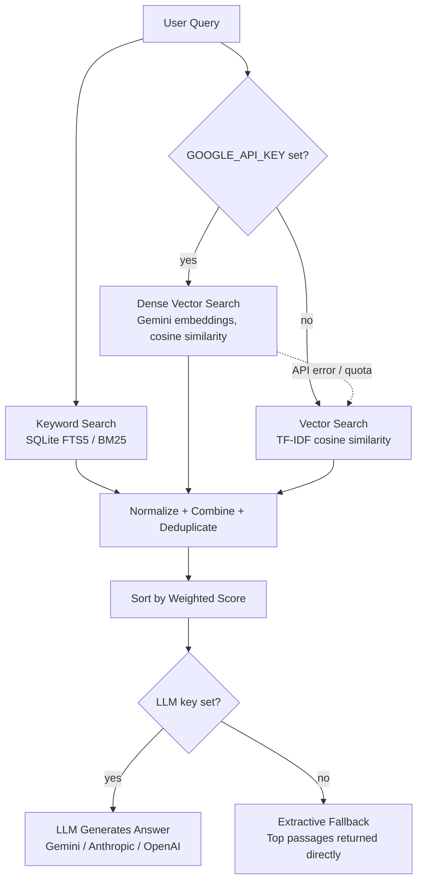

# Hybrid Search RAG Demo

> **Live demo: https://YOUR-GITHUB-USERNAME.github.io/rag-demo/** — *placeholder: replace after you deploy (see [Deploy to Render](#deploy-to-render)).*
> The demo sleeps when idle (free tier). This link opens a short loading page that wakes it
> and redirects automatically, usually within a minute — please share this one, not the raw `onrender.com` URL.

A small, standalone retrieval-augmented generation (RAG) app that answers questions over a set of sample documents using **hybrid search** — keyword search and dense vector search combined, deduplicated, and ranked — plus a **retrieval evaluation harness** that measures whether the hybrid approach actually beats either half.

This isn't a toy pipeline with a single `similarity_search()` call. It's built the way I build these in production: a hybrid retrieval layer, a pluggable generation step that degrades gracefully with no API key, measured retrieval quality, tests, CI, and guards for running on the public internet. No client code or data is in this repo — the sample documents are synthetic placeholder policy text I wrote for this demo.

## How it works



- **Vector search** uses dense `gemini-embedding-2` embeddings when `GOOGLE_API_KEY` is set. Corpus embeddings are computed once and cached on disk (keyed by a hash of the chunk text), so only the user's query is embedded per request — and repeated queries are served from an in-memory LRU.
- **With no API keys at all** the app still runs end to end: vector search falls back to TF-IDF and answers are extractive (the top retrieved passages, returned directly). This zero-setup path is deliberate — clone, `pip install`, run. If the embedding API fails at runtime (quota, timeout), queries degrade to TF-IDF automatically, and the response says so (`vector_backend`).
- **Fusion:** BM25 scores and cosine similarities live on different scales, so each list is min-max normalized per query before the weighted sum (0.4 keyword + 0.6 vector).

## Retrieval evaluation

`eval/evaluate_retrieval.py` scores keyword-only, vector-only and hybrid retrieval on 20 labelled queries covering all 8 documents, through the same `retrieve()` the API uses.

```bash
python -m eval.evaluate_retrieval                       # console table
python -m eval.evaluate_retrieval --markdown eval/results.md
GOOGLE_API_KEY=... python -m eval.evaluate_retrieval    # also scores dense Gemini embeddings
```

**Method.** Ground truth is document-level (each query is labelled with the one document that answers it; a retrieved chunk is relevant if it comes from that document). Metrics: **P@k** (fraction of the top-k chunks that are relevant — note that documents have only 2–4 chunks, so P@3 can't reach 1.0 for the smaller ones), **Hit@3** (any relevant chunk in the top 3), and **MRR** (mean reciprocal rank of the first relevant chunk). Queries are tagged *lexical* (shares rare terms with the answer), *paraphrase* (little vocabulary overlap), or *mixed*, so results can be broken down by type. If the dense backend degrades to the TF-IDF fallback mid-run, its results are discarded rather than mislabelled.

### Results

Evaluated 20 queries over 8 documents (document-level ground truth, chunk-level retrieval, top-10).

#### Overall

| Method                        | Vector backend             | P@1   | P@3   | Hit@3 | MRR   |
|-------------------------------|----------------------------|-------|-------|-------|-------|
| Keyword only (BM25)           | n/a                        | 0.900 | 0.583 | 0.950 | 0.933 |
| Vector only                   | TF-IDF                     | 0.850 | 0.617 | 0.950 | 0.902 |
| **Hybrid** (0.4 kw + 0.6 vec) | TF-IDF                     | 0.900 | 0.617 | 0.950 | 0.933 |
| Keyword only (BM25)           | n/a                        | 0.900 | 0.583 | 0.950 | 0.933 |
| Vector only                   | Dense (gemini-embedding-2) | 0.950 | 0.833 | 1.000 | 0.967 |
| **Hybrid** (0.4 kw + 0.6 vec) | Dense (gemini-embedding-2) | 0.950 | 0.783 | 1.000 | 0.975 |

#### Hybrid lift (by MRR)

| Vector backend             | Best single method | MRR lift (abs) | MRR lift (rel) | W/T/L vs keyword | W/T/L vs vector |
|----------------------------|--------------------|----------------|----------------|------------------|-----------------|
| TF-IDF                     | keyword            | +0.000         | +0.0%          | 0/20/0           | 2/17/1          |
| Dense (gemini-embedding-2) | vector             | +0.008         | +0.9%          | 2/18/0           | 1/18/1          |

*W/T/L = queries where hybrid's reciprocal rank is higher / equal / lower.*

#### MRR by query type — TF-IDF vector backend

| Query type | n | Keyword | Vector | Hybrid |
|------------|---|---------|--------|--------|
| lexical    | 6 | 1.000   | 1.000  | 1.000  |
| mixed      | 5 | 1.000   | 0.900  | 1.000  |
| paraphrase | 9 | 0.852   | 0.837  | 0.852  |

#### MRR by query type — Dense (gemini-embedding-2) vector backend

| Query type | n | Keyword | Vector | Hybrid |
|------------|---|---------|--------|--------|
| lexical    | 6 | 1.000   | 1.000  | 1.000  |
| mixed      | 5 | 1.000   | 0.867  | 1.000  |
| paraphrase | 9 | 0.852   | 1.000  | 0.944  |

**Reading the results honestly.**

- **Dense embeddings help where they should.** Swapping TF-IDF for `gemini-embedding-2` lifts vector-only MRR from 0.902 to 0.967, and on *paraphrase* queries (little shared vocabulary) from 0.837 to 1.000. E.g. *"plug my own USB drive into a work computer"* vs the policy's *"personal storage devices"* moved from rank 6 to rank 2 in the hybrid ranking.
- **Hybrid is best overall, by a hair.** With dense vectors, hybrid reaches MRR 0.975 vs 0.967 (vector-only) and 0.933 (keyword-only): it wins on 2 queries against keyword-only and loses on none, but against vector-only it's 1 win / 1 loss. That +0.008 is noise at this scale — I'm not claiming a lift over dense vector search.
- **Hybrid isn't free.** On paraphrase queries hybrid (0.944) is *below* dense vector-only (1.000), because the keyword signal drags in lexically similar but wrong chunks. Hybrid's real value is robustness — it never does badly on either query type (keyword-only is weakest on paraphrases, vector-only on the "mixed" queries that mix exact terms with paraphrase) — and the 0.4/0.6 weights are hand-picked, not tuned.
- On the keyless TF-IDF configuration, hybrid simply ties keyword-only.
- **Scale caveat:** 20 queries I wrote myself over 8 short documents (24 chunks) is smoke-test scale; differences of a few points are within noise. The value here is the methodology and a reproducible harness (tested, runs in CI), not a leaderboard number. Results above were produced with a real `GOOGLE_API_KEY`; CI has no key, so it only runs the TF-IDF half.

## Why hybrid search

Keyword search alone misses a query like "notice period" when the document says "30 days in advance." Vector search alone can miss an exact term like "RFP" or a dollar threshold that matters more than semantic similarity. Combining both and letting each catch what the other misses is the same approach I use in production retrieval systems — this repo is a minimal, runnable illustration of that pattern, and the **"Compare keyword-only, vector-only and hybrid"** toggle in the UI lets you check it per query instead of taking my word for it.

## Project layout

```txt
app/
  main.py        FastAPI app: startup indexing, /search, /compare, /health
  ingest.py      Load sample docs, chunk them, build the keyword (FTS5) index
  vector.py      Vector backends: dense Gemini index + TF-IDF index, with auto-fallback
  embeddings.py  Gemini embedding client, query LRU, on-disk corpus cache
  search.py      Hybrid retrieval: normalize, combine, dedupe, rank (3 modes)
  generate.py    Pluggable LLM provider (Anthropic / OpenAI / Gemini / extractive)
  config.py      Tolerant env-var parsing (quotes / inline comments from any source)
  safety.py      Rate limiting, client-IP handling, body-size cap, query validation
  schemas.py     Pydantic request/response models
eval/            Retrieval evaluation harness + labelled queries + latest results
tests/           pytest suite (unit + FastAPI integration), no network or keys needed
scripts/         build_embedding_cache.py (precompute embeddings), check_gemini.py (API diagnostic)
data/sample_docs/  Eight synthetic sample policy documents (not real client data)
static/index.html  Minimal single-page frontend
docs/              Static loading page (GitHub Pages) that wakes the sleeping server and redirects
Dockerfile, docker-compose.yml, render.yaml, .github/workflows/ci.yml
```

## Run locally

```bash
git clone <this-repo-url>
cd rag-demo
python3 -m venv .venv && source .venv/bin/activate
pip install -r requirements.txt
uvicorn app.main:app --reload
```

Open **[localhost](http://127.0.0.1:8000)** and try a query like:

> How much notice do I need to give for medical leave?

With no keys you get TF-IDF vector search and extractive answers — no signup, no cost. To switch on the full pipeline, copy `.env.example` to `.env` and fill in a key. The app loads `.env` automatically at startup (real environment variables take precedence, which is how Render supplies them), so restarting is all it takes:

```bash
cp .env.example .env             # then edit: GOOGLE_API_KEY=...  (dense embeddings + Gemini answers)
# optional, answer generation only: ANTHROPIC_API_KEY=... or OPENAI_API_KEY=...
pip install -r requirements-optional.txt   # Anthropic/OpenAI SDKs
uvicorn app.main:app --reload
```

The startup log and `GET /health` report which vector backend and LLM mode are active.

**Model choices live in `.env`, not in code:**

| Variable | Default | Purpose |
| -------- | ------- | ------- |
| `GEMINI_EMBEDDING_MODEL` | `gemini-embedding-2` | Embedding model for vector search |
| `GEMINI_EMBEDDING_DIM` | `768` | Embedding dimensionality |
| `GEMINI_GENERATION_MODEL` | `gemini-flash-lite-latest` | Model for generated answers (Flash-Lite: more free-tier throughput) |

Change one, restart, done. Switching the embedding model or dimension re-embeds the corpus once (the on-disk cache is keyed by both, so vector spaces are never mixed); older models that take `task_type` (`gemini-embedding-001`, `text-embedding-*`) are handled automatically. The same variables are set in `render.yaml`, where you can also override them in the dashboard.

If several keys are set, answer generation prefers Anthropic, then OpenAI, then Gemini; embeddings always use `GOOGLE_API_KEY`.

**Tests:** `pip install -r requirements-dev.txt && pytest`

**Docker:** `docker compose up --build`, then open [localhost](http://127.0.0.1:8000). Compose injects your `.env` as environment variables when the container starts. `.env` is deliberately **not** copied into the image (a secret baked into a layer travels with the image), so a plain `docker build && docker run` starts in keyless mode — pass `--env-file .env` to `docker run` (or use Compose) to give it your keys. The container binds to `$PORT` (8000 locally, 10000 on Render).

**Precomputed embeddings (optional):** `GOOGLE_API_KEY=... python -m scripts.build_embedding_cache` writes `data/embeddings_cache/*.npy`. Commit it and a fresh container never has to embed the corpus. Without it, the first startup embeds the 24 chunks once (one API call).

## API

`POST /search` — ranked passages plus an answer.

```json
{ "query": "What happens if I don't reconcile my corporate card on time?", "top_k": 5, "generate_answer": true }
```

Returns the passages (with keyword / vector / combined scores so you can see how hybrid ranking works), an `answer` flagged as `"generated"` or `"extractive"`, and `vector_backend` (`gemini-embedding-2`, `tfidf`, or `tfidf (fallback)`).

`POST /compare` — `{ "query": "...", "top_k": 5 }` → the keyword-only, vector-only and hybrid rankings for the same query, with no LLM call.

`GET /health` — status, chunk count, active vector backend and LLM mode.

## Safety measures for the public instance

A public endpoint backed by someone's API quota needs guarding. All of these are in `app/safety.py` and covered by tests:

| Guard | Behaviour |
| ----- | --------- |
| Per-IP rate limit | 10 requests/minute (`RATE_LIMIT`), shared by `/search` and `/compare`; `429` + `Retry-After` |
| Global rate limit | 300 requests/hour across *all* clients (`GLOBAL_RATE_LIMIT`) — the backstop that caps worst-case API spend even against many IPs or a spoofed `X-Forwarded-For` |
| Query length cap | 500 characters, declared in the schema **and** re-checked in the handler (`checked_query`), which also strips control characters and rejects whitespace-only queries |
| Body size cap | Requests over 16 KB are rejected with `413` *before* parsing, including chunked uploads with no `Content-Length` |
| Graceful degradation | If the embedding API or LLM fails or exceeds its timeout (10 s embeddings, 15 s generation by default, no retries), the request falls back (TF-IDF / extractive) instead of returning a 500, and the failing provider is skipped for 60 s so one outage doesn't slow every visitor |
| CORS | Off by default; `CORS_ALLOW_ORIGINS` allows only the loading page's origin, `GET` only, no credentials |
| Secrets | API keys are environment variables only; `.env` is git-ignored and `render.yaml` declares them with `sync: false` |

**Client IP and `X-Forwarded-For`.** Behind a proxy the socket address is the proxy's, so per-IP limiting must read `X-Forwarded-For`; but clients can forge that header and proxies *append* to it. The app therefore trusts only the entry added by infrastructure it controls — the `TRUSTED_PROXY_HOPS`-th entry from the right — and ignores the header entirely when that is `0` (the local default).

Even with limits, also give the Google key its own project with a quota cap or budget alert.

## Deploy to Render

Everything is defined in `render.yaml` (Docker runtime, free plan, `/health` check), so deploying is one Blueprint action.

1. **Push to GitHub.** If this folder isn't a git repo yet: `git init && git add . && git commit -m "Initial commit"`, create an empty GitHub repo, then `git remote add origin <url> && git push -u origin main`. (Optional: run `python -m scripts.build_embedding_cache` first and commit the `.npy`.)
2. **Create a Render account** at [render.com](https://render.com) (free; sign in with GitHub).
3. **New → Blueprint.** Connect your GitHub account, pick this repo and branch. Render reads `render.yaml` and shows the `hybrid-rag-demo` web service on the free plan.
4. **Add secrets.** Render prompts for `GOOGLE_API_KEY` (declared `sync: false`, so the value lives only in Render). Paste a key from [Google AI Studio](https://aistudio.google.com/apikey), or leave it blank to deploy the keyless version. Click **Apply**. To use Anthropic or OpenAI answers as well: *Service → Environment → Add Environment Variable* → `ANTHROPIC_API_KEY` / `OPENAI_API_KEY` (their SDKs are already in the image).
5. **Wait for the first deploy** (a few minutes; watch *Logs*). Look for `Indexed 24 chunks … vector backend: gemini-embedding-2` (or `tfidf` if keyless).
6. **Confirm the health check passes.** The service shows **Live** in the dashboard (Render only routes traffic once `/health` returns 2xx). Then:

   ```bash
   curl https://<your-service>.onrender.com/health
   # {"status":"ok","chunks_indexed":24,"vector_backend":"gemini-embedding-2","llm_mode":"generated"}
   ```

7. **Verify the rate limiter sees real client IPs** (1 minute, once). Render doesn't document how many entries its edge adds to `X-Forwarded-For`, so check that the `TRUSTED_PROXY_HOPS=2` default is right. This sends 12 requests, each with a different *forged* header:

   ```bash
   for i in $(seq 1 12); do
     curl -s -o /dev/null -w "%{http_code} " -X POST https://<your-service>.onrender.com/compare \
       -H 'content-type: application/json' -H "X-Forwarded-For: 203.0.113.$i" -d '{"query":"leave"}'
   done
   ```

   Expect `200` ×10, then `429`. If you never see a `429`, the forged entries are being trusted: set `TRUSTED_PROXY_HOPS=1` in the Render dashboard. If different people get throttled together, the opposite is true — the log line `rate limit hit: key=… x-forwarded-for=…` shows what the app sees.
8. **Set up the loading page** (so visitors never see Render's generic cold-start screen —
   see [Loading page](#loading-page-for-cold-starts) below).
9. **Put the loading page's URL at the top of this README** and commit.

**Free-tier behaviour:** the instance spins down after 15 minutes without traffic and takes about a minute to wake; 512 MB RAM (this app uses ~130 MB); 750 free instance hours/month; the filesystem is ephemeral. Fine for a portfolio demo, not for production.

### Loading page for cold starts

A free Render instance sleeps after 15 idle minutes, and anyone who arrives then sees Render's own "service waking up" screen for about a minute. That screen is served by Render's proxy while the app isn't running, so the app can't replace it. Instead, `docs/` holds a small static page hosted on **GitHub Pages** (always on, free) that you share as the demo link. It shows a polite "thanks for your patience" message with a live timer, polls the app's `/health`, and redirects the moment the app answers with real JSON (Render's wake-up HTML is never mistaken for "ready"). If the server hasn't responded after 4 minutes it apologises and offers *Try again* / *Open directly*.

Setup (once, after your first Render deploy):

1. Edit `docs/config.js`: set `appUrl` to your Render URL (and optionally `repoUrl`).
2. In Render → your service → *Environment*, set **`CORS_ALLOW_ORIGINS`** to your Pages origin, e.g. `https://YOUR-GITHUB-USERNAME.github.io` (scheme + host only, no path). The loading page lives on a different origin, so the browser needs this to let it read `/health`. The app allows only that origin and only `GET`.
3. Push, then in GitHub → *Settings → Pages* choose **Deploy from a branch**, branch `main`, folder **`/docs`**. The page appears at `https://YOUR-GITHUB-USERNAME.github.io/<repo>/`.
4. Test it: let the service sleep (15+ minutes idle), then open the Pages URL.

If `CORS_ALLOW_ORIGINS` is missing or wrong the page can't tell when the server is up; it will still show the waiting message and, after 25 seconds, offer a direct link. **Trade-off:** the raw `onrender.com` URL still shows Render's screen when asleep, so only publish the Pages URL. (Alternatively, an external uptime pinger every ~10 minutes keeps the instance awake; one free service fits within Render's 750 monthly hours, but that uses most of your allowance, so I chose the loading page.)

## What this demo still simplifies

- **In-memory corpus and indices.** Eight static documents are chunked and indexed at startup; there is no ingestion API, incremental update, or persistent vector store. Production systems I've built use a real vector database (pgvector, OpenSearch) with managed ingestion. A 24-row NumPy matrix needs none of that, but it doesn't scale.
- **In-memory SQLite FTS5** instead of a managed search service — same BM25 ranking concept, no infrastructure.
- **Naive chunking** — fixed-size character chunks on paragraph boundaries; no semantic or structure-aware splitting, no reranker, and the 0.4/0.6 fusion weights are hand-picked rather than learned.
- **Small evaluation set** — 20 author-written queries and document-level labels (see the caveats above); no significance testing or held-out set.
- **No auth and no per-user accounts.** Abuse protection is IP-based rate limiting held in process memory, which is right for one instance; multiple replicas would need a shared store (e.g. Redis).
- **No persistence across restarts** (ephemeral filesystem on the free tier); the query-embedding cache and rate-limit counters reset on every spin-down.
- **No guardrails beyond a "use only the excerpts" system prompt** — no prompt-injection defence or answer-grounding check.

## Tech stack

Python, FastAPI, SQLite (FTS5), scikit-learn (TF-IDF fallback), Gemini API (configurable embedding and generation models; defaults `gemini-embedding-2` and `gemini-flash-lite-latest`), slowapi, pytest, Docker, GitHub Actions, Render. Optional: Anthropic or OpenAI SDK for generation.

## License

MIT — see [LICENSE](LICENSE).
